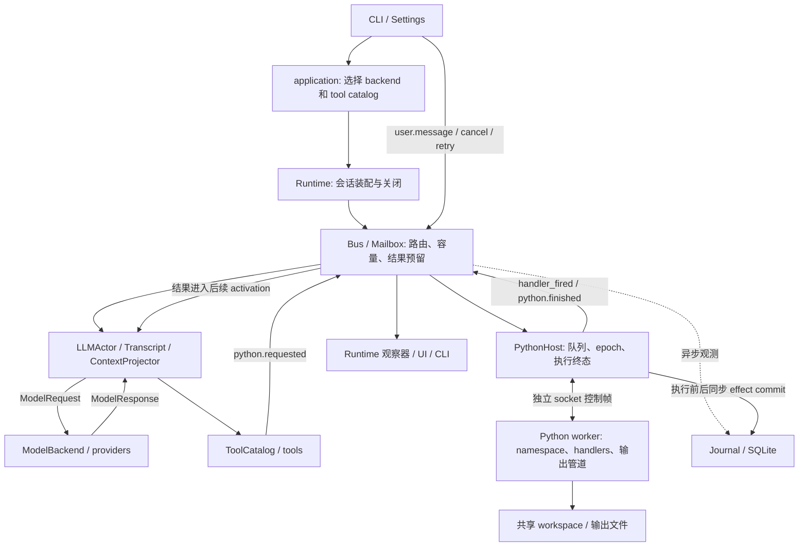

# 当前实现架构

本文是当前工作区实现的架构入门与模块导航，随代码更新。使用方式见 [README](../README.md)，文档分工见 [文档索引](README.md)。研究日志记录当时的观察与实验，论文组织研究论证；二者不替代本文对当前代码的说明。初稿基于源码审阅；过程性验证记录见[研究日志](runtime_harness_architecture_research.md)与 §7，各轮测试只覆盖当时执行的范围，不能外推为当前全量验收。

## 1. 控制链与依赖

Nervipulsa 在一个宿主 asyncio loop 内协调事件、模型 actor、Python host 与 UI；Python 代码在独立的持久解释器进程里串行执行。模型生成结束后提交工具请求，无需等待 Python 执行结束，即可处理后续输入。actor 自身仍串行等待当前模型请求或摘要请求；这期间事件留在邮箱。

图中箭头是控制或数据流，不全是 Python import。`ports.py` 定义中立数据类型及协议；`application.py` 是默认适配器选择点；`runtime.py` 是会话装配点。Bus 根据 `Runtime._register()` 的固定表路由至一个接收邮箱，没有通用广播调度器。`python.finished` 路由至 actor，Runtime 同时通过同步观察器渲染结果。

单次 CLI 指定正数 `--process-timeout` 时，`cli.main()` 在父进程同步调用 `supervision.run_supervised()`；Runtime 与上述 asyncio loop 整体放入受控子进程。未开启时仍沿原有入口运行。

## 2. 从用户请求到执行终态

1. CLI 加载 `Settings`，解析 workspace，经 `application.create_runtime()` 选择 backend、tool catalog 并创建 Runtime。`Runtime.start()` 先在线程中取得 canonical journal path/session 的非阻塞 OS 文件锁，再启动 Journal、等待初始化 flush、读取持久事件序号边界。占用冲突抛 `SessionBusyError`，CLI 返回 `rejected/session_busy`，不读取历史、不发布输入、不请求模型。`await runtime.start(restore_transcript=True)` 在线程中读取最后提交的快照，并在启动 Bus、host 和 actor/UI/lifecycle 任务前应用模型视图。worker 启动有独立的 ready 等待，Bus 启动不等于解释器已经 ready。
2. `Runtime.submit_text()` 同步调用 emitter。`Bus.call()` 检查运行状态、路由、有限 JSON 快照、事件大小和邮箱容量，再赋会话内 seq/id 并投递。返回 `Delivery` 是进程内接受回执，不是磁盘提交或业务完成确认。`submit_text()` 与 `submit_observation()` 将 actor 持有的 paused 输入和 ordinary mailbox 队列合并计入输入容量；`Runtime.retry()` 使用独立的单项 `Lane.RETRY`，普通输入占满时仍可提交 retry。观察器在接受后被同步调用，Journal 观察记录仅入有界线程队列。
3. `LLMActor.run()` 按 seq 取批，`_activate()` 将输入投影到 Transcript，消费邮箱预留，建立 Activation。`ContextProjector` 在请求时加入 host 的实时 epoch/未完成执行事实。上下文限制按序列化 JSON 字符估计，非 tokenizer token；必要时先请求模型摘要，摘要成功且可安全应用才替换历史片段。完整的普通轮次和已有摘要都可以参与压缩；超限或预算耗尽会暂停。
4. actor 经 `ModelBackend.complete(ModelRequest)` 请求模型；默认 provider 是 OpenAI-compatible Chat Completions HTTP 适配器。actor 校验整个响应的工具调用，再记录 assistant 内容并按顺序调用 catalog 中的工具。原生 tool 消息记录的是工具回执。无工具的 assistant 文本可结束本次 activation，但不意味着此前提交的 Python 都完成。
5. `PythonExecTool.invoke()` 提交 `python.requested`，同时在 actor 邮箱预留一个执行终态槽和最多 16 个 handler 槽。拒绝时不执行；接受时以请求事件 id 作为 execution_id，立即返回 accepted 回执。activation 的 `committed` 表示响应及回执处理完成，不表示 Python 已完成。内置 `python_environment` 则在宿主线程中做静态发现后发送独立结果事件，不经过 worker/effect 协议。
6. host 接收请求建 Execution，串行从 `_pending` 调度。在发送 execute 帧之前，先同步提交 `intent`，再提交 `dispatching`；任一失败都不发送。worker 的 started 帧到达后才记录真实执行计时并发 `python.started`，执行超时从这里计算，另有启动等待期限。
7. worker 在每次执行前恢复 cwd，以同一 namespace 执行代码，捕获异常和输出。`SystemExit(None)` 和整数零退出按成功结束当前执行，非零整数和非整数退出值按失败处理；这些路径都保留 namespace，不退出 worker。结束时固定 handler 快照，发送 `handler.snapshot`、逐个 `handler.fired` 和 `finished`。回调在 worker 中同步执行，其耗时及失败也受 host 的等待/超时约束。
8. host 校验 request/epoch/handler 快照，接收 worker terminal 后先同步提交 effect `observed`。提交失败则返回失败终态并标明 `effect_state=unknown`。host 在 loop 上交付 handler 结果，计算缺失项，再通过预留槽发一次 `python.finished`；`_done` 防止本会话重复生成终态，投递失败另记计数。actor 有界合并 handler 结果（兼容旧生产者的 25ms 窗口），将观测加入后续 activation，模型再决定下一步。

标识关联：session_id 是持久会话作用域，默认每个 Runtime 随机生成，也可显式用于顺序续接；event id/seq 在会话内唯一。显式会话启动时从 events、输入记录、effect 和 receipt 的已保存 ID 恢复序号边界，不能只取 transcript 中残留的 ID，否则 assistant/UI 事件会与下一轮输入冲突并造成日志丢失。activation_id 关联一次输入批次和模型提交；tool_call_id 关联模型调用与回执；execution_id 是 `python.requested` 的 event id，`python.finished.reply_to` 指向它。SQLite 查询始终需要 session_id。相同 journal/session 的并发 Runtime 在启动时明确拒绝，不同 session 可共用 journal。

Actor 的 activation/transcript snapshot 与 tool receipt 仍走同步 FULL 事务接口，但调用前在 loop 内冻结独立 payload，再通过 `asyncio.to_thread` 执行 SQLite 并 await 结果。初始输入快照提交成功前不调用 provider；receipt 提交成功前不推进后续工具；最终 commit/pause 成功或明确失败后才发布对应 settlement。取消不能撤销已经开始的 SQLite 调用，因此 actor 先等待线程退出并完成必要状态转换，Runtime 才能结束清理、释放会话锁。

显式 retry 也遵守这些顺序：输入快照失败须先重新提交再请求模型；已经接纳的工具若 receipt 提交失败，actor 保留该 activation 的分离回执，retry 只补交回执再继续，不重复调用工具。该状态仅存在于当前 actor 内，不随 transcript restore 恢复，不新增自动重试或 effect replay。

这消除的是 actor 在 event loop 上等待磁盘/SQLite 锁的路径，不把单会话 actor 或 Python namespace 变成并行执行。共享 journal 仍受 SQLite 单 writer 约束，线程池、JSON/快照复制、同步 listener 和真实 provider 也仍可能限制吞吐；需按 workload 和 journal 布局分别测量。

会话锁由 Windows byte-range lock 或 POSIX flock 持有，文件名哈希包含 canonical journal path 和 session_id。锁文件不删除，避免新旧 inode 同时被持有；进程死亡由 OS 释放句柄。启动取消先等待线程中的取得锁/Journal 初始化操作结束再清理；shutdown 取消也等待 host/actor 清理及 Journal writer 真正停止，随后才释放本实例的锁。这保证正常生命周期内不会在旧 writer 仍活动时交出会话，不是分布式锁或硬退出期限。

输入到输出的关联是公开接口，不要求宿主扫描 ledger：`Runtime.activation_for_event(event_id)` 常数时间返回消费该输入的 activation；`await Runtime.wait_for_activation(input_event_id=..., timeout=...)` 在该 activation 不再 `running` 时返回，`None` 表示超时、尚无消费，或该输入被停在只能由显式 retry 解除的 pause 之后。每次 settle 递增 `Activation.settle_version`；retry 之后传入 `after_version` 等待下一次结果。同一次 settle 还会以 `agent.activation_finished` 进入 trace 与 journal，payload 为 `{activation_id, input_event_ids, status, error_kind, ended_at, settle_version}`。retry 复用同一 activation 对象，因此 `input_event_ids` 在重试前后保持稳定。

内存中的模型 view 由 `context_limit` 约束：压缩会保留首条和当前输入作为原文锚点，并折叠较早的完整普通轮次、已完成工具交互和旧摘要；无法安全压缩的超限输入会暂停。`Transcript.archive` 只保留最近 256 条、合计最多 256 Ki 字符的历史消息，较早条目计入 `archive_dropped`。`Transcript.seen` 保留 active view 的 event IDs 与最近 4,096 个已处理 ID；更旧且不再 active 的 ID 会过期。每次 activation 的 durable transcript snapshot 仍保存在 SQLite Journal 中，不驻留在这些进程内窗口里。

`ACTIVATION_SNAPSHOT_RETENTION`（32）个最近已提交 activation 保留完整请求视图与 `context_metrics["input_events"]`。当前 paused activation 保留精确请求视图以供 retry；请求 attempt 总数保存在 `attempt_count`，只保留最近 32 条详情，错误文本最长 1,024 字符，并报告 `attempts_evicted`。

`actor.activations` 在内存中保留最近至多 `ACTIVATION_LEDGER_RETENTION`（256）个对象，`activation_count` 仍报告 Runtime 生命周期总数；按 event 和 activation id 的索引随对象一起过期，过期关联可从 journal 检查。当前 running/paused activation 不因窗口裁剪。`Runtime.trace` 保留最近至多 1,024 个事件，`Runtime.event_count(event_type=None)` 提供累计计数；journal writer 的丢弃/错误状态仍由 `journal.incomplete`、`journal.dropped` 暴露。

CLI 的 `--prompt` 将一条任务提交后等待 idle、pause 或期限到达；`--json` 的 stdout 只输出结果对象，诊断输出到 stderr。成功表示最后 activation 已 committed、运行时空闲且清理完成，不代表模型任务已被独立验收。`final_message` 只包含成功运行的最后 activation 中无工具调用的已记录文本，所有失败/暂停/超时/拒绝路径均为 null；`last_message={activation_id,text}` 单独提供本次调用最近的已记录发言，可为中间进度。提交钩子失败的响应不进入任一字段。初始化/恢复失败返回非零和失败 JSON，清理失败不能同时报告 succeeded。`--run-timeout` 从输入提交后（管道模式从 EOF 后）开始限制完成等待，期限到达后仍执行 shutdown；线程中的阻塞 HTTP、进程清理及等待 journal writer 停止可能推迟最终退出。已退出的 one-shot 通过 `--resume` 创建新 activation，仅恢复 transcript，不重试旧 paused activation、不重放或解决未知 effect。

`--process-timeout` 为 opt-in 的外层进程期限，只接受 `--prompt`；计时从父进程参数/配置加载后、子进程启动前开始，覆盖 startup、执行、shutdown 与 executor 中阻塞 HTTP 的退出等待，超时后额外最多 5 秒用于 OS 清理和回收。Windows 子进程在父进程取得 Job Object 所有权后才通过启动门；POSIX worker 在父监护器确认登记 PID 后才离开 runtime 进程组创建自己的 session，关闭登记窗口中的泄漏风险。正常 worker 的独立 timeout/cancel 仍由 host 处理。硬期限到达时父进程停止 runtime 组及已登记 worker 组，或终止 Windows Job。监督进程保留 child stdout 至整个子进程退出，不能在 executor 仍阻塞时先报告成功。

监护结果增加 `supervision={process_timeout,timed_out,tree_stopped,child_exit_code}`。强制终止返回 `timeout/124`，无法确认的 admission/activation/text 均为 null，不能据此推断“未执行”；Journal 观测队列可能来不及落盘，effect ledger 可保留 dispatching/unknown。清理失败另标 `cleanup_incomplete`。该机制不是实时 OS 保证，也不约束主动脱离受控进程组的用户进程；Windows AppContainer 因 ACL/profile 清理无法有界完成，开启硬期限时在启动前拒绝此组合。

POSIX 监护依赖 `waitid(WNOWAIT)` 保留未回收的组长身份，直到 group 清理完成或监护器确认解除登记，防止已回收 PID 被复用后误杀无关进程；缺少此原语时在启动前拒绝监护模式。Linux 还检查 `/proc` 中的 group/state，避免把已停止但尚未回收的 zombie 误报为仍在执行。

## 3. 模块职责与状态归属

| 模块 | 负责 | 状态归属与边界 |
| --- | --- | --- |
| `config.py` | 默认值、profile、CLI/环境/用户文件覆盖、配置保存与展示脱敏 | Settings 是会话配置；优先级 CLI > 已映射环境变量 > 用户文件 > 默认值，非所有字段都有环境映射 |
| `application.py` | 默认 provider/tool registry、构造入口 | 接受 registry 或 callable；保留 runtime_factory 签名兼容路径，不拥有执行状态 |
| `ports.py` | ModelRequest/Response、ToolCall、backend/tool/catalog/context/sink/registry 协议 | 契约与传值类型；不做调度或持久化 |
| `runtime.py` | 路由、组件生命周期、状态/日志接口、结果展示 | 拥有 Bus、邮箱、host、actor、Journal、trace/listeners；配置热更新只替换 provider 相关设置及 backend/model |
| `session_lock.py` | 每个 canonical journal/session 的非阻塞 OS 文件锁 | descriptor 归属单个 Runtime；持有至清理完成，进程死亡自动释放；文件保留不代表仍被占用 |
| `supervision.py` | 单次 CLI 的同步父进程监护、启动门、硬期限与最终回执 | 父进程拥有 Windows Job / POSIX 登记进程组；已解析的 Settings/prompt 经私有通道传递，保留宿主 proxy/TLS 环境；强制中断只报告已知状态，不恢复/重放 effect |
| `events.py` | JSON 边界、校验、同步 admission、邮箱与预留 | Bus 拥有 session、seq、路由及 CREATED/RUNNING/DRAINING/CLOSED；Mailbox 分别限制 ordinary 输入、单项 retry、结果、handler、feedback 与 diagnostic lane |
| `llm.py` | 输入投影、上下文预算/摘要、单次模型请求、响应提交与暂停/重试 | actor 拥有 Activation、held 输入、已接受/拒绝调用状态及 Transcript；ContextProjector 构建模型视图，不拥有 worker namespace |
| `providers.py` | HTTP 协议映射、错误分类与脱敏；ScriptedBackend | 实现 ModelBackend；不执行工具，不隐式恢复 Python |
| `tools.py` | schema、参数验证、内置工具适配与 catalog | 接收窄 ToolContext，经 EventSink 发事件；扩展工具的失败/副作用语义由其实现负责 |
| `python_environment.py` | 静态包、项目和 API 发现 | 宿主侧只读发现，不导入目标模块执行，不安装依赖 |
| `python_host.py` | 串行执行队列、worker 生命周期、取消、超时、帧关联、终态与 effect 提交 | host 拥有 Execution、pending/current/done、epoch、handler 关联镜像、诊断计数；不调用模型 |
| `python_worker.py` | compile/exec、持久 namespace、handler 注册/快照、输出捕获 | namespace/回调仅存在于该 worker epoch；host 镜像只用于关联和投递 |
| `framing.py` / `process_tree.py` / `appcontainer.py` | 长度前缀 JSON socket、过滤环境和进程树管理、可选 Windows 隔离 | worker 以 `-P` 从宿主 runtime 路径启动，完成加载后再加入 workspace 以供用户模块导入；控制帧与用户输出分离，平台清理失败必须保留诊断 |
| `journal.py` | 异步观测表、同步 durable effect 表、人工评估与查询 | 两条写入路径共用 SQLite 文件，提交保证不同；不是通用状态恢复引擎 |
| `hashline_edit.py` | worker 可调用的文件快照/tag、共享字节预算的单/多文件分页与受限 PUT 编辑 | 单次返回总共至多 3 KiB；批量最多 8 个片段，共享输出预算并各带续读游标。同一文件在批内只读取和计算 tag 一次，仍按全文件快照拒绝陈旧编辑；不约束任意 Python 文件访问 |
| `cli.py` | 交互输入、命令、配置与展示 | 经 application/Runtime 使用会话，退出时发起清理 |

这些文件是实际边界，不要求每项都成为一个新服务或抽象层。

## 4. 状态生命周期与失败语义

- **Runtime**：CREATED → RUNNING → DRAINING → CLOSED。draining 拒绝新 user.message、python.requested、agent.retry，仍允许处理取消与结果。普通 user.message / runtime.observation 受 `ordinary_limit` 限制，容量同时计算 actor 的 held 输入；`agent.retry` 有独立的一个 mailbox 槽。shutdown 停止 actor，关闭 host，再关闭 Bus、取消剩余 UI/lifecycle 任务并限时 flush/close Journal；它不等待模型完成所有业务意图。
- **Execution**：host 的 record 从 queued → running → done，终态 payload 再区分 succeeded/failed/timeout/cancelled；调度已标 running 与 worker 实际 started 是不同时间点，`active_execution_facts()` 仅在后者后报告计时。
- **Scheduler 异常边界**：执行及 `_apply_result` 在同一个 try 内，异常沿既有 `worker_exit` 失败路径处理，并清理 current/executing、取消旧 namespace 队列及重启 worker。该边界不新增异步观测失败到 effect 状态的映射；Journal 异步 execution 观测与同步 durable effect commit 仍是不同契约。它也不保证第二次结果处理再次抛错时仍可恢复。
- **Resume 状态机（仅记录不自动推进）**：`committed/observed` 表示已落盘可检查；`observed-but-unconsumed`（T4：effect 已 observed 且 python.finished 进了旧 LLM mailbox，但新会话收不到）标记为“待继续（inspectable, not resumable）”，只能人工用 `/inspect` 查看后手动发新 user.message 继续，绝不由 Runtime 自动重放、回填 mailbox 或恢复 namespace；`commit_interrupted/response_unknown` 仍需显式 `/retry`，且只在原进程内有效。
- **Worker epoch**：正常成功、普通 Python 异常都保留 namespace；执行超时、运行中取消或进程退出需要重建解释器。旧 epoch 排队代码会取消，避免在新 namespace 自动重放。空闲 worker 死亡可通过 environment_changed 通知 actor。排队取消无需销毁当前 namespace。
- **Handler**：worker 的 on_finished/off_finished 管理注册；每次执行结束固定最多 16 个回调的快照。host 的 epoch/request/id 检查及邮箱预留防止跨执行串接；终态携带 expected count、missing ids 与 complete/incomplete/unknown，不能把缺帧当成成功完成。终态槽在 actor 消费结果后释放，取批本身不释放该额度。

执行 `status` 与 `effect_state` 是两个维度。`failed` 仍可能已改文件；`observed` 只表示 worker 的终态被持久记录；`unknown` 表示无法确认效果完成情况，绝不等于未执行。`not_started` 用于明确未发送/排队取消等路径，`untracked` 留给没有 Journal 的直接 host 用法。进程死亡或 socket 写入失败不能通过重放补成确定结果。

## 5. 持久性边界

| 数据/路径 | 提交保证 | 重启后能做什么 |
| --- | --- | --- |
| Bus admission、邮箱、Activation、Transcript、namespace（活对象） | 进程内内存状态 | 新建 Runtime 不恢复这些对象或继续原任务；durable 行为下仍不回填 mailbox、不重建 namespace |
| events/deliveries/activations/executions/tool_calls | Journal 有界队列，后台线程批量写入，WAL + NORMAL | 查询已落盘观测；队列溢出/写失败通过 incomplete/dropped/error 暴露；接受与展示不保证观测已落盘 |
| durable_effects | 独立同步连接，FULL commit；intent → dispatching → observed，无法确认时尽力改 unknown | `/effects` 查询所有非 observed 行；崩溃可能保留 intent/dispatching；没有自动执行或重放 |
| durable_activation_commits / durable_transcript_snapshots / durable_tool_receipts | 独立同步连接，FULL + BEGIN IMMEDIATE，单事务提交 activation 行 + transcript 快照；receipt 单独同步提交；失败显式抛错并转 paused（commit_interrupted），不静默丢 | `/inspect [session_id]` 只读检查上次会话的 activation/transcript/receipt；明确标注“可检查、不可自动继续”；绝不自动重放 python、不推回 mailbox、不恢复 namespace |
| effect_assessments | 同步 FULL commit、追加人工 assessment | 保存谁基于什么证据作出判断；不修改 worker 事实、不将原 effect 改 observed、不触发 replay |
| `.nervipulsa/outputs/<session>/` | worker 输出管道写文件，大输出保留 artifact；非 effect 事务的一部分 | 终态引用存在时可 `/output` 读取完整流；进程中断、文件丢失或观察记录缺失可使完整输出不可用 |
| workspace / 外部系统 | 任意 Python 自身的副作用 | 文件或网络副作用可跨 namespace 重置保留；无回滚或跨系统事务 |

`dispatching` 在写 socket **之前**持久提交，表示进入可能发送的窗口，不是 worker 收到帧的凭据。`observed` 在发布 python.finished **之前**提交，仍可能出现“持久终态存在、模型尚未收到”的窗口。Journal 的同步 effect 提交不依赖异步观察队列成功，异步日志缺失也不自动证明 effect 未发生。FULL 的耐久性依赖底层 SQLite/文件系统/设备保证，不提供外部效果 exactly-once。

协议详情及既有故障注入记录见 [Durable Effect Protocol](durable_effect_protocol.md)。[Failure semantics baseline](failure_semantics.md) 固定在协议前版本，不能用来证明当前 effect 协议。

## 6. 安全边界

默认 worker 以当前用户权限执行任意 Python，workspace 只是 cwd，既不是访问根也不是沙箱。host 过滤传给 worker 的环境，配置 API key 不主动写入 journal/worker 环境；这不阻止默认 worker 以用户权限读取其他文件。journal、输出、代码和模型请求可能包含任务数据，不能视为脱敏存储。provider 地址与凭据是显式信任边界。

Windows 的 `NERVIPULSA_WINDOWS_APPCONTAINER=1` 是独立的实验性 opt-in：使用无 capability 的 AppContainer、临时 ACL 和 Job Object；启动前拒绝链接/reparse point/硬链接，设置失败不回退到普通进程。该 worker 还必须能**读取自己的解释器目录**（容器启动第一步是加载 `python.exe` 及其 DLL），而 host 只对 runtime package 授权、不对解释器本身授权：Windows Store 版 Python 已对应用包授予读权限可直接使用，python.org / `hostedtoolcache` 类安装默认只授权 SYSTEM、Administrators 与交互用户，需要显式给解释器目录加 `ALL APPLICATION PACKAGES` 读权限，否则 worker 会在运行任何 Python 之前退出——host 现在会报告退出码与解释器路径，而不是仅给出空的启动错误。扫描与 ACL 之间仍有外部并发修改窗口，也不提供完整资源限制。详见 README 的执行边界。Hashline 的路径/tag 检查只保护该编辑 API；独立 socket 只防正常 stdout/stderr 混入控制帧，不构成对恶意 worker 的认证隔离。

文件状态历史不在本运行时内：`--fingerprint-workspace` 已于 2026-10-21 删除（每次执行扫两遍全树、未经运行时验证；历史见 git）。文件差异排查用版本控制或外部工具，不在执行路径里做全树哈希。

## 7. 整理决策与验证范围

整理过程中合并了同一边界内重复的出队记账与 handler 快照校验；随后恢复 scheduler 与 HEAD 一致的执行及结果处理异常边界。不新增层，不改变事件/schema/工具回执、SQLite schema 或重试协议。README 保留使用与扩展示例，本文集中解释实现，研究日志与论文保留原日期和证据范围。

以下复杂点保留，需后续单独决策：

- **application 与 Runtime、registry 与 catalog**：分别承担适配器选择、会话装配和工具实例查找；直接合并会破坏现有注入、callable 和 runtime_factory 兼容契约。`providers` 的旧 schema 导出同理保留。
- **Transcript 与 ContextProjector、旧 compact 与模型摘要路径**：前者记录与后者视图语义不同，旧接口存在兼容调用；去掉其中之一前需要调用面和上下文保留规则的独立验收。
- **Journal 两种写入、两次执行前 commit**：观测与执行放行的失败处理不同，合并为队列或一个事务会改动 durable effect 崩溃窗口。该轮只纠正说明，不改协议。
- **Host 的线程/loop 分工与 handler 镜像**：阻塞 IPC、进程终止与 SQLite 放在线程，Bus 交付留在 loop；镜像承担关联校验，并非 namespace 的第二份权威状态。重写并发模型风险大于该轮收益。
- **内存保留窗口**：activation snapshot、activation ledger、trace、Transcript archive、seen event IDs 与 retry attempt 详情均有进程内上限；active model view 在可压缩时受 `context_limit` 限制。持久 Journal 的 transcript snapshots 会继续随 activation 累积，这是磁盘保留策略，不是驻留内存增长；超大且不可压缩的输入仍会暂停。
- **错误展示路径**：`agent.error → ui_box` 路由已于 2026-10-21 注册；同日再增加有界诊断预留：`ui_box` 为 `ordinary_limit=256 + diagnostic_limit=16`，`agent.error` 全量改走 `Lane.DIAGNOSTIC`，普通队列满时诊断仍可接纳（单一 FIFO 消费顺序不变）。诊断预留也满时返回显式 `diagnostic_capacity_exceeded`、记 `diagnostic_dropped` 计数并向 stderr 直报一行，不伪装成功、不丢旧消息、不扩容。接纳保证不等于显示保证：UI 任务停滞时诊断只是在队列里等，不会被自动显示。
- **fingerprint（已删除 2026-10-21）**：`workspace_fingerprint.py` 及整条 wiring（Settings/Runtime/host/CLI/`/logs`/docs）已移除。文件状态历史不是本运行时的职责；差异排查交给版本控制或外部工具。

### 验证记录

- 2026-10-21 durable memory 切片：Transcript/Activation/tool receipt 增加同步 durable 提交（FULL + BEGIN IMMEDIATE，失败显式抛错转 commit_interrupted），重启后 `/inspect` 只读可查、绝不自动重放；新增 `tests/test_durable_memory.py` 5 项（commit 失败显式报错、落盘往返、重启可读且新会话空转、无重放、失败转暂停），本地 `python -m pytest tests/test_durable_memory.py -q` 5 passed；证据分层：本地验证通过，hosted CI / 长跑 / 真实模型未验证。
- 2026-11-12 文档整理：不改代码；合并 `feat/configurable-agent-profile` 后全量 `python -m pytest -q` 221 passed（Windows / Python 3.13.14 / pytest 9.1.1），覆盖新增的 activation correlation、transcript restore、structured observation、no-Python-host 及既有 worker/CLI/provider 测试。该结果仍是本机单次运行，不代表 hosted CI、长跑或真实模型验收。
- 2026-11-13 actor 持久化线程化：输入快照、receipt、最终 settlement 和取消/显式 retry 边界的新增测试 14 项通过；既有 actor 测试 29 项与持久化、恢复、崩溃边界、会话锁、CLI、observation 相关测试 106 项通过，共 149 项。首次组合执行在 600 秒被终止，原因未确定；之后分组完成。共享 journal 负载仍观察到初始化锁失败；聚焦测试通过不等于负载或生产验收。命令、矩阵、观察记录缺失和证据边界见 [验证记录](../TEST_RESULTS.md#durable-runtime-throughput-study-2026-11-13)。
- 更早的验证范围：初稿整理仅做静态检查；后续 scheduler 修复运行完整的 `python -m pytest tests/test_events.py tests/test_python_host.py -vv`，Windows / Python 3.13.14 / pytest 9.1.1 下 30 passed（163.80s），包含真实 worker、取消/重启及 durable commit 故障替身。新增回归在内存恢复回退实现时失败，证明覆盖该异常边界问题。当时未重现 startup flush 失败，未调整 timeout；一次通过不能排除间歇性 startup 问题。未运行全库测试、CLI/provider 或扫描竞态专项验证，以上测试不构成这些行为的验收。

- 2026-11-13：新增单次子代理调用与 JSON 结果、显式会话续接；实跑发现并修复 `SystemExit(0)` 误报失败及续接复用 event id 导致观测静默丢失的问题。最终 live 运行验证一次 Python 执行、跨进程记忆与既有 SQLite 事件保留；测试阶段及 HTTP 超时边界见 [验证记录](../TEST_RESULTS.md#one-shot-and-resume-smoke-2026-11-13)。未据此宣称并发同会话写入、硬进程期限或生产任务质量已验收。
- 2026-11-13 结果/会话收紧：`final_message` 与 `last_message` 分离，同一 journal/session 用 OS 锁明确拒绝并发；相关 CLI、锁、恢复、可选 host 和 T0–T4 回归 **83 passed in 59.94s**。空配置目录下的真实 CLI bugfix/独立验证/跨进程续接/复用拒绝验收通过 27 项条件；脚本与保留证据见 [验证记录](../TEST_RESULTS.md#subagent-result-and-session-ownership-acceptance-2026-11-13)。硬进程期限、POSIX 实跑、跨平台与长时间 live 验收仍未建立。
- 2026-11-13 进程监护：新增单次调用的 `--process-timeout`、启动门与整棵受管进程树终止；相关 supervision、CLI、worker、OS lock 和 AppContainer 回归 **95 passed in 116.92s**。新增 executor 退出阻塞、HTTP 超时和工具后代终止场景；监护下真实任务验收通过 37 项条件。命令、产物与边界见 [验证记录](../TEST_RESULTS.md#supervised-process-deadlines-2026-11-13)。POSIX 实跑、hosted CI 与长时间稳定性仍未验证。
