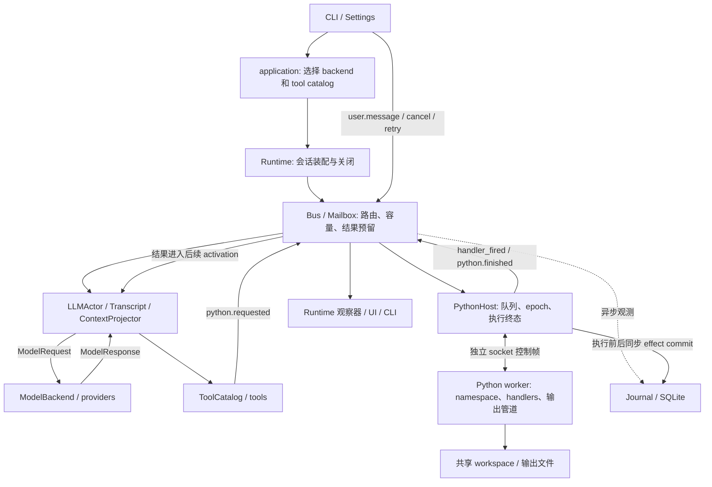

# 当前实现架构

本文是当前工作区实现的架构入门与模块导航，随代码更新。使用方式见 [README](../README.md)，文档分工见 [文档索引](README.md)。研究日志记录当时的观察与实验，论文组织研究论证；二者不替代本文对当前代码的说明。初稿基于源码审阅；2026-10-18 scheduler 回退修复及 events + python_host 聚焦组的验证过程见[研究日志](runtime_harness_architecture_research.md)。本轮未运行 CLI 或真实 provider。

scheduler 保留 HEAD 的异常边界：执行及 `_apply_result` 均在同一个 try 内，异常沿既有 `worker_exit` 失败路径处理，并清理 current/executing、取消旧 namespace 队列及重启 worker。此次恢复不新增异步观测失败到 effect 状态的映射；Journal 异步 execution 观测与同步 durable effect commit 仍是不同契约。该边界也不保证第二次结果处理再次抛错时仍可恢复。

## 1. 控制链与依赖

Nervipulsa 在一个宿主 asyncio loop 内协调事件、模型 actor、Python host 与 UI；Python 代码在独立的持久解释器进程里串行执行。模型生成结束后提交工具请求，无需等待 Python 执行结束，即可处理后续输入。actor 自身仍串行等待当前模型请求或摘要请求；这期间事件留在邮箱。

图中箭头是控制或数据流，不全是 Python import。`ports.py` 定义中立数据类型及协议；`application.py` 是默认适配器选择点；`runtime.py` 是会话装配点。Bus 根据 `Runtime._register()` 的固定表路由至一个接收邮箱，没有通用广播调度器。`python.finished` 路由至 actor，Runtime 同时通过同步观察器渲染结果。

## 2. 从用户请求到执行终态

1. CLI 加载 `Settings`，解析 workspace，经 `application.create_runtime()` 选择 backend、tool catalog 并创建 Runtime。注册路由后，`Runtime.start()` 启动 Journal 并等待初始化 flush，再启动 Bus、host 和 actor/UI/lifecycle 任务。worker 启动有独立的 ready 等待，Bus 启动不等于解释器已经 ready。
2. `Runtime.submit_text()` 同步调用 emitter。`Bus.call()` 检查运行状态、路由、有限 JSON 快照、事件大小和邮箱容量，再赋会话内 seq/id 并投递。返回 `Delivery` 是进程内接受回执，不是磁盘提交或业务完成确认。观察器在接受后被同步调用，Journal 观察记录仅入有界线程队列。
3. `LLMActor.run()` 按 seq 取批，`_activate()` 将输入投影到 Transcript，消费邮箱预留，建立 Activation。`ContextProjector` 在请求时加入 host 的实时 epoch/未完成执行事实。上下文限制按序列化 JSON 字符估计，非 tokenizer token；必要时先请求模型摘要，摘要成功且可安全应用才替换历史片段。超限或预算耗尽会暂停。
4. actor 经 `ModelBackend.complete(ModelRequest)` 请求模型；默认 provider 是 OpenAI-compatible Chat Completions HTTP 适配器。actor 校验整个响应的工具调用，再记录 assistant 内容并按顺序调用 catalog 中的工具。原生 tool 消息记录的是工具回执。无工具的 assistant 文本可结束本次 activation，但不意味着此前提交的 Python 都完成。
5. `PythonExecTool.invoke()` 提交 `python.requested`，同时在 actor 邮箱预留一个执行终态槽和最多 16 个 handler 槽。拒绝时不执行；接受时以请求事件 id 作为 execution_id，立即返回 accepted 回执。activation 的 `committed` 表示响应及回执处理完成，不表示 Python 已完成。内置 `python_environment` 则在宿主线程中做静态发现后发送独立结果事件，不经过 worker/effect 协议。
6. host 接收请求建 Execution，串行从 `_pending` 调度。在发送 execute 帧之前，先同步提交 `intent`，再提交 `dispatching`；任一失败都不发送。worker 的 started 帧到达后才记录真实执行计时并发 `python.started`，执行超时从这里计算，另有启动等待期限。
7. worker 在每次执行前恢复 cwd，以同一 namespace 执行代码，捕获异常和输出。结束时固定 handler 快照，发送 `handler.snapshot`、逐个 `handler.fired` 和 `finished`。回调在 worker 中同步执行，其耗时及失败也受 host 的等待/超时约束。
8. host 校验 request/epoch/handler 快照，接收 worker terminal 后先同步提交 effect `observed`。提交失败则返回失败终态并标明 `effect_state=unknown`。host 在 loop 上交付 handler 结果，计算缺失项，再通过预留槽发一次 `python.finished`；`_done` 防止本会话重复生成终态，投递失败另记计数。actor 有界合并 handler 结果（兼容旧生产者的 25ms 窗口），将观测加入后续 activation，模型再决定下一步。

标识关联：session_id 区分每次 Runtime；event id/seq 只在会话内唯一；activation_id 关联一次输入批次和模型提交；tool_call_id 关联模型调用与回执；execution_id 是 `python.requested` 的 event id，`python.finished.reply_to` 指向它。SQLite 的 event/execution/effect 查询需要保留 session_id，不能只用短事件 id 跨会话查找。

## 3. 模块职责与状态归属

| 模块 | 负责 | 状态归属与边界 |
| --- | --- | --- |
| `config.py` | 默认值、profile、CLI/环境/用户文件覆盖、配置保存与展示脱敏 | Settings 是会话配置；优先级 CLI > 已映射环境变量 > 用户文件 > 默认值，非所有字段都有环境映射 |
| `application.py` | 默认 provider/tool registry、构造入口 | 接受 registry 或 callable；保留 runtime_factory 签名兼容路径，不拥有执行状态 |
| `ports.py` | ModelRequest/Response、ToolCall、backend/tool/catalog/context/sink/registry 协议 | 契约与传值类型；不做调度或持久化 |
| `runtime.py` | 路由、组件生命周期、状态/日志接口、结果展示 | 拥有 Bus、邮箱、host、actor、Journal、trace/listeners；配置热更新只替换 provider 相关设置及 backend/model |
| `events.py` | JSON 边界、校验、同步 admission、邮箱与预留 | Bus 拥有 session、seq、路由及 CREATED/RUNNING/DRAINING/CLOSED；Mailbox 拥有待取批事件、leased 记录和结果/handler/feedback 额度 |
| `llm.py` | 输入投影、上下文预算/摘要、单次模型请求、响应提交与暂停/重试 | actor 拥有 Activation、held 输入、已接受/拒绝调用状态及 Transcript；ContextProjector 构建模型视图，不拥有 worker namespace |
| `providers.py` | HTTP 协议映射、错误分类与脱敏；ScriptedBackend | 实现 ModelBackend；不执行工具，不隐式恢复 Python |
| `tools.py` | schema、参数验证、内置工具适配与 catalog | 接收窄 ToolContext，经 EventSink 发事件；扩展工具的失败/副作用语义由其实现负责 |
| `python_environment.py` | 静态包、项目和 API 发现 | 宿主侧只读发现，不导入目标模块执行，不安装依赖 |
| `python_host.py` | 串行执行队列、worker 生命周期、取消、超时、帧关联、终态与 effect 提交 | host 拥有 Execution、pending/current/done、epoch、handler 关联镜像、诊断计数；不调用模型 |
| `python_worker.py` | compile/exec、持久 namespace、handler 注册/快照、输出捕获 | namespace/回调仅存在于该 worker epoch；host 镜像只用于关联和投递 |
| `framing.py` / `process_tree.py` / `appcontainer.py` | 长度前缀 JSON socket、过滤环境和进程树管理、可选 Windows 隔离 | 控制帧与用户输出分离；平台清理失败必须保留诊断 |
| `journal.py` | 异步观测表、同步 durable effect 表、人工评估与查询 | 两条写入路径共用 SQLite 文件，提交保证不同；不是通用状态恢复引擎 |
| `workspace_fingerprint.py` | 可选执行前后文件树摘要与差异标记 | 只提供 execution metadata，不决定 effect 状态、权限或重试 |
| `hashline_edit.py` | worker 可调用的文件快照/tag 与受限 PUT 编辑 | 防陈旧编辑的局部工具，不约束任意 Python 文件访问 |
| `cli.py` | 交互输入、命令、配置与展示 | 经 application/Runtime 使用会话，退出时发起清理 |

这些文件是实际边界，不要求每项都成为一个新服务或抽象层。

## 4. 状态生命周期与失败语义

- **Runtime**：CREATED → RUNNING → DRAINING → CLOSED。draining 拒绝新 user.message、python.requested、agent.retry，仍允许处理取消与结果。shutdown 停止 actor，关闭 host，再关闭 Bus、取消剩余 UI/lifecycle 任务并限时 flush/close Journal；它不等待模型完成所有业务意图。
- **Activation**：输入投影后 running，响应/工具回执处理完成为 committed；provider 异常、未知响应、预算、上下文或提交中断会 paused。已知响应提交中断时，`/retry` 沿已有 response 和调用状态继续，跳过已 accepted/rejected 的调用；无响应时重试可能重新请求 provider。此保护只在当前进程内有效，工具副作用已发生但回执未记下的窗口仍存在。未知响应或 commit_interrupted 需要显式 retry，不因普通新输入自动重试。上下文超限单纯 retry 无法缩小记录。
- **Execution**：host 的 record 从 queued → running → done，终态 payload 再区分 succeeded/failed/timeout/cancelled；调度已标 running 与 worker 实际 started 是不同时间点，`active_execution_facts()` 仅在后者后报告计时。
- **Resume 状态机（v0.5 起，仅记录不自动推进）**：`committed/observed` 表示已落盘可检查；`observed-but-unconsumed`（T4：effect 已 observed 且 python.finished 进了旧 LLM mailbox，但新会话收不到）标记为“待继续（inspectable, not resumable）”，只能人工用 `/inspect` 查看后手动发新 user.message 继续，绝不由 Runtime 自动重放、回填 mailbox 或恢复 namespace；`commit_interrupted/response_unknown` 仍需显式 `/retry`，且只在原进程内有效。
- **Worker epoch**：正常成功、普通 Python 异常都保留 namespace；执行超时、运行中取消或进程退出需要重建解释器。旧 epoch 排队代码会取消，避免在新 namespace 自动重放。空闲 worker 死亡可通过 environment_changed 通知 actor。排队取消无需销毁当前 namespace。
- **Handler**：worker 的 on_finished/off_finished 管理注册；每次执行结束固定最多 16 个回调的快照。host 的 epoch/request/id 检查及邮箱预留防止跨执行串接；终态携带 expected count、missing ids 与 complete/incomplete/unknown，不能把缺帧当成成功完成。终态槽在 actor 消费结果后释放，取批本身不释放该额度。

执行 `status` 与 `effect_state` 是两个维度。`failed` 仍可能已改文件；`observed` 只表示 worker 的终态被持久记录；`unknown` 表示无法确认效果完成情况，绝不等于未执行。`not_started` 用于明确未发送/排队取消等路径，`untracked` 留给没有 Journal 的直接 host 用法。进程死亡或 socket 写入失败不能通过重放补成确定结果。

## 5. 持久性边界

| 数据/路径 | 提交保证 | 重启后能做什么 |
| --- | --- | --- |
| Bus admission、邮箱、Activation、Transcript、namespace（活对象） | 进程内内存状态 | 新建 Runtime 不恢复这些对象或继续原任务；durable 行为下仍不回填 mailbox、不重建 namespace |
| events/deliveries/activations/executions/tool_calls | Journal 有界队列，后台线程批量写入，WAL + NORMAL | 查询已落盘观测；队列溢出/写失败通过 incomplete/dropped/error 暴露；接受与展示不保证观测已落盘 |
| durable_effects | 独立同步连接，FULL commit；intent → dispatching → observed，无法确认时尽力改 unknown | `/effects` 查询所有非 observed 行；崩溃可能保留 intent/dispatching；没有自动执行或重放 |
| durable_activation_commits / durable_transcript_snapshots / durable_tool_receipts | 独立同步连接，FULL + BEGIN IMMEDIATE，单事务提交 activation 行 + transcript 快照；receipt 单独同步提交；失败显式抛错并转 paused（commit_interrupted），不静默丢 | `/inspect [session_id]` 只读检查上次会话的 activation/transcript/receipt；明确标注“可检查、不可自动继续”；绝不自动重放 python、不推回 mailbox、不恢复 namespace |
| effect_assessments | 同步 FULL commit、追加人工 assessment | 保存谁基于什么证据作出判断；不修改 worker 事实、不将原 effect 改 observed、不触发 replay |
| `.nervipulsa/outputs/<session>/` | worker 输出管道写文件，大输出保留 artifact；非 effect 事务的一部分 | 终态引用存在时可 `/output` 读取完整流；进程中断、文件丢失或观察记录缺失可使完整输出不可用 |
| workspace / 外部系统 | 任意 Python 自身的副作用 | 文件或网络副作用可跨 namespace 重置保留；无回滚或跨系统事务 |

`dispatching` 在写 socket **之前**持久提交，表示进入可能发送的窗口，不是 worker 收到帧的凭据。`observed` 在发布 python.finished **之前**提交，仍可能出现“持久终态存在、模型尚未收到”的窗口。Journal 的同步 effect 提交不依赖异步观察队列成功，异步日志缺失也不自动证明 effect 未发生。FULL 的耐久性依赖底层 SQLite/文件系统/设备保证，不提供外部效果 exactly-once。

协议详情及既有故障注入记录见 [Durable Effect Protocol](durable_effect_protocol.md)。[Failure semantics baseline](failure_semantics.md) 固定在协议前版本，不能用来证明当前 effect 协议。

## 6. 安全与 fingerprint

默认 worker 以当前用户权限执行任意 Python，workspace 只是 cwd，既不是访问根也不是沙箱。host 过滤传给 worker 的环境，配置 API key 不主动写入 journal/worker 环境；这不阻止默认 worker 以用户权限读取其他文件。journal、输出、代码和模型请求可能包含任务数据，不能视为脱敏存储。provider 地址与凭据是显式信任边界。

Windows 的 `NERVIPULSA_WINDOWS_APPCONTAINER=1` 是独立的实验性 opt-in：使用无 capability 的 AppContainer、临时 ACL 和 Job Object；启动前拒绝链接/reparse point/硬链接，设置失败不回退到普通进程。该 worker 还必须能**读取自己的解释器目录**（容器启动第一步是加载 `python.exe` 及其 DLL），而 host 只对 runtime package 授权、不对解释器本身授权：Windows Store 版 Python 已对应用包授予读权限可直接使用，python.org / `hostedtoolcache` 类安装默认只授权 SYSTEM、Administrators 与交互用户，需要显式给解释器目录加 `ALL APPLICATION PACKAGES` 读权限，否则 worker 会在运行任何 Python 之前退出——host 现在会报告退出码与解释器路径，而不是仅给出空的启动错误。扫描与 ACL 之间仍有外部并发修改窗口，也不提供完整资源限制。详见 README 的执行边界。Hashline 的路径/tag 检查只保护该编辑 API；独立 socket 只防正常 stdout/stderr 混入控制帧，不构成对恶意 worker 的认证隔离。

`--fingerprint-workspace` 保留为默认关闭的观测能力。启用后 host 在每次调度执行前后通过线程扫描共享树，排除任意深度 `.git` 和 `.nervipulsa`，摘要包含相对路径、节点类型、普通文件内容和符号链接目标文字。扫描失败记录 error/unavailable；两个 available 摘要不同时 changed=true，否则相同为 false，无法比较为 null。结果只进 executions.metadata_json 和 `/logs`，不进入 python.finished/model context，也不写入 effect ledger。

其收益是为人工排查提供低侵入的前后差异线索；代价是每次执行两次全树读取，增加 I/O、延迟及路径记录内存。它不是原子快照，不归因于单次执行：编辑器/其他进程可改树，执行可改完再还原，外部副作用和被排除树不覆盖。权限、时间等元数据不进入摘要；路径大小写排序带平台语义。当前遍历虽不主动跟随已识别符号链接，但扫描与读取之间的替换竞态、Windows reparse/junction 行为仍需专项验证，不能用作安全边界。当前没有 LayerFS、增量缓存、快照恢复或以摘要相等推导安全重放的实现。

## 7. 本轮整理与保留的决策

本轮整理合并同一边界内重复的出队记账与 handler 快照校验；随后恢复 scheduler 与 HEAD 一致的执行及结果处理异常边界。不新增层，不改变事件/schema/工具回执、SQLite schema 或重试协议。README 保留使用与扩展示例，本文集中解释实现，研究日志与论文保留原日期和证据范围。

以下复杂点保留，需后续单独决策：

- **application 与 Runtime、registry 与 catalog**：分别承担适配器选择、会话装配和工具实例查找；直接合并会破坏现有注入、callable 和 runtime_factory 兼容契约。`providers` 的旧 schema 导出同理保留。
- **Transcript 与 ContextProjector、旧 compact 与模型摘要路径**：前者记录与后者视图语义不同，旧接口存在兼容调用；去掉其中之一前需要调用面和上下文保留规则的独立验收。
- **Journal 两种写入、两次执行前 commit**：观测与执行放行的失败处理不同，合并为队列或一个事务会改动 durable effect 崩溃窗口。本轮只纠正说明，不改协议。
- **Host 的线程/loop 分工与 handler 镜像**：阻塞 IPC、进程终止与 SQLite 放在线程，Bus 交付留在 loop；镜像承担关联校验，并非 namespace 的第二份权威状态。重写并发模型风险大于本轮收益。
- **预留与 trace 的生命周期**：容量预留有终态交付意义，不能按普通队列简化。`Mailbox` 原先的 `_leased` 字典只写不读、且是会话内无界增长，已于 2026-10-21 删除（消费后不再持有事件）。`Runtime.trace`、执行记录和 Transcript archive 仍随会话增长；是否逐步释放、设上限或改变调试可见性，需要先定保留契约。
- **错误展示路径**：`agent.error → ui_box` 路由已于 2026-10-21 注册；同日再增加有界诊断预留：`ui_box` 为 `ordinary_limit=256 + diagnostic_limit=16`，`agent.error` 全量改走 `Lane.DIAGNOSTIC`，普通队列满时诊断仍可接纳（单一 FIFO 消费顺序不变）。诊断预留也满时返回显式 `diagnostic_capacity_exceeded`、记 `diagnostic_dropped` 计数并向 stderr 直报一行，不伪装成功、不丢旧消息、不扩容。接纳保证不等于显示保证：UI 任务停滞时诊断只是在队列里等，不会被自动显示。
- **fingerprint**：保留刚授权能力；预算/取消响应、平台链接行为、稳定快照及是否需要更丰富差异属于后续评估，不因架构偏好删除，也不扩成新存储层。

2026-10-21 durable memory 切片：Transcript/Activation/tool receipt 增加同步 durable 提交 （FULL + BEGIN IMMEDIATE，失败显式抛错转 commit_interrupted），重启后 `/inspect` 只读可查、绝不自动重放；新增 `tests/test_durable_memory.py` 5 项（commit 失败显式报错、落盘往返、重启可读且新会话空转、无重放、失败转暂停），本地 `python -m pytest tests/test_durable_memory.py -q` 5 passed；证据分层：本地验证通过，hosted CI / 长跑 / 真实模型未验证。

验证范围：初稿整理仅做静态检查；后续 scheduler 修复运行完整 `python -m pytest tests/test_events.py tests/test_python_host.py -vv`，Windows / Python 3.13.14 / pytest 9.1.1 下 30 passed（163.80s），包含真实 worker、取消/重启及 durable commit 故障替身。新增回归在内存恢复回退实现时失败，证明覆盖本次异常边界问题。本次未重现 startup flush 失败，未调整 timeout；一次通过不能排除间歇性 startup 问题。未运行全库测试、CLI/provider 或扫描竞态专项验证，以上测试不构成这些行为的验收。
